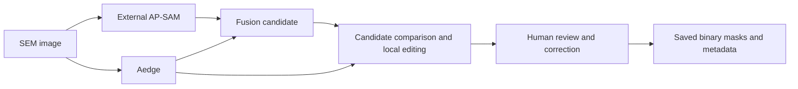

# SEM Pore Annotation Toolkit

**Research preview v0.1.0 · 多模型辅助孔隙标注工具**

A desktop tool for reviewing and correcting precomputed pore masks in paired,
registered SEM images. Compare Aedge and AP-SAM-derived fusion candidates, select
local additions or replacements, then manually correct and save separate masks.
The interface is currently in Chinese. See [English usage guide](docs/USAGE.md).

本项目面向多倍率岩石 SEM 图像中单一模型表现不稳定时的辅助标注工作。
使用 AP-SAM 与 Aedge 生成候选结果后，由人对照、局部融合并修正。
不同倍率可分别处理；每个 Before/After 图对须处于相同像素网格。
多倍率不代表可以直接将不同尺度图像相减，也不代表模型具备尺度不变性。

## Workflow



### What is included

- A four-pane Tkinter editor for paired images and candidate masks.
- ROI addition/replacement, brush addition/erasing, connected-region deletion,
  undo/redo and independent output storage with checksums.
- Optional Aedge and gated fusion architecture/loss code in `models/`.
- A geometric synthetic demo generator and tests that use temporary synthetic data.
- Optional connection to an external SAM session API; ordinary editing needs no server.

### What is not included

No experimental images, human labels, previews, private metadata, model weights,
cached tensors, training runs, upstream AP-SAM implementation or trained inference
service are distributed. The synthetic demo does **not** evaluate model accuracy.
This release is an annotation application plus model components, not a complete
trained AP-SAM inference or experiment-reproduction package.

## Quick start (Python 3.11 or 3.12)

```bash
python -m venv .venv
# Windows PowerShell:
.venv\Scripts\Activate.ps1
# Linux/macOS: source .venv/bin/activate
python -m pip install -r requirements.txt
python demo_synthetic.py --workspace demo_workspace
python fusion_editor.py --workspace demo_workspace
```

Tkinter is required (normally included with Windows Python; Linux may need
`python3-tk`). A graphical desktop is needed for the editor. PyTorch and model
weights are **not** needed for the synthetic demo or editing existing masks.
The generator refuses to overwrite an existing workspace.

在左侧选择 Before 或 After；选择“框选融合区域”，在图像中拖出选区，
选择 Aedge 或 SAM 后点击“局部补充”或“局部替换”。可继续使用画笔、
整块删除、撤销和重做；Ctrl+S 将结果保存到工作区的 `new integrate mask/`。
`SAM` 是历史界面的来源槽位名称，可放入 AP-SAM 或 edgeSAM 派生候选，
应自行记录具体来源。输入候选快照不被保存操作覆盖。

## Models and evidence limits

The Aedge architecture here is the version used by the original fusion workflow,
not Aedgethree_v2. The historical internal name `edgeSAM` refers to the local
fusion experiments, not the separate published EdgeSAM model for edge devices.
See [model scope](docs/MODELS.md) and [attribution](docs/ATTRIBUTION.md).

The conservative v2 fusion preserves AP positives and selects Aedge additions;
it can preserve AP false positives. Human correction is essential. No superior
cross-magnification accuracy or annotation-time reduction has been established
by this release. Corrected masks are annotations, not guaranteed ground truth.

## Verification and publication

```bash
python -m unittest discover -s tests -v
# Optional model forward/backward checks:
python -m pip install -r requirements-models.txt
python -m unittest discover -s tests -v
python tools/audit_public_files.py
```

The repository uses an exact publication allowlist: new files are ignored until
explicitly reviewed and added. This also excludes synthetic files generated at
runtime. Read [release policy](docs/RELEASES.md) before publishing any update.

This is a public research preview. No blanket open-source license grant is
included yet; see [attribution and licensing status](docs/ATTRIBUTION.md).
